# PyroScan

[](https://github.com/1rishipathak/pyroscan/actions/workflows/ci.yml)

**the farm fires satellites miss.**

in india we count stubble fires with satellites that pass over punjab between 10:30 am and 1:30 pm. farmers now burn in the late afternoon. so the official fire count fell 93% in punjab between 2021 and 2025, while the fields kept burning.

PyroScan doesn't look for fire. it looks for what fire leaves behind, the black char on a harvested field, in every sentinel-2 image of the season. then it checks every burnt field against the same satellites the official count uses, and tells you which burns nobody counted.


## Mermaid Diagram

```mermaid
flowchart TD

subgraph group_burn["Burn analysis"]
  node_config["Study configuration<br/>[config.py]"]
  node_scene_access["Scene access<br/>[s2.py]"]
  node_timeline["Clear-look timeline<br/>[timeline.py]"]
  node_indices["Burn indices and labels<br/>[indices.py]"]
  node_training["U-Net training<br/>[04_train.py]"]
  node_model["U-Net model<br/>[model.py]"]
  node_inference["Season inference<br/>[05_infer.py]"]
end

subgraph group_context["Fire context"]
  node_official_sources["Official count ingestion<br/>[sources.py]"]
  node_tinyfish["TinyFish client<br/>[tinyfish_client.py]"]
  node_news["Enforcement news<br/>[news.py]"]
  node_firms["FIRMS detections<br/>[firms.py]"]
  node_insat["INSAT fire analysis<br/>[mosdac.py]"]
end

subgraph group_publish["Results and dashboard"]
  node_emissions["Smoke estimates<br/>[emissions.py]"]
  node_geo["Punjab geography<br/>[geo.py]"]
  node_hotspots["Village hotspots<br/>[08b_hotspots.py]"]
  node_assets["Dashboard data generation<br/>[08_web_assets.py]"]
  node_dashboard["Interactive dashboard<br/>[app.js]"]
  node_api["HTTP API<br/>[main.py]"]
  node_timelapse["Season timelapse<br/>[11_timelapse.py]"]
end

subgraph group_external["External data"]
  node_s2[("Sentinel-2 scenes")]
  node_official["Official bulletins"]
  node_tinyfish_service{{"TinyFish APIs"}}
  node_insat_service[("INSAT-3DR scans")]
end

node_researcher(("Analyst"))

node_scene_access -->|"uses settings"| node_config
node_timeline -->|"uses settings"| node_config
node_timeline -->|"loads scenes"| node_scene_access
node_training -->|"uses settings"| node_config
node_training -->|"trains"| node_model
node_inference -->|"uses settings"| node_config
node_inference -->|"uses burn indices"| node_indices
node_inference -->|"walks scenes"| node_timeline
node_inference -->|"runs model"| node_model
node_official_sources -->|"uses settings"| node_config
node_official_sources -->|"fetches bulletins"| node_tinyfish
node_tinyfish -->|"queries"| node_tinyfish_service
node_news -->|"uses settings"| node_config
node_news -->|"searches and reads"| node_tinyfish
node_insat -->|"reads fire scans"| node_insat_service
node_assets -->|"uses settings"| node_config
node_assets -->|"calculates emissions"| node_emissions
node_assets -->|"uses scene data"| node_scene_access
node_assets -->|"uses geography"| node_geo
node_assets -->|"publishes dashboard data"| node_dashboard
node_hotspots -->|"uses settings"| node_config
node_researcher -->|"views results"| node_dashboard
node_researcher -.->|"requests data"| node_api
node_timelapse -->|"uses settings"| node_config
node_s2 -->|"provides imagery"| node_scene_access
node_official -->|"provides bulletins"| node_official_sources

click node_config "https://github.com/1rishipathak/pyroscan/blob/main/pyroscan/config.py"
click node_scene_access "https://github.com/1rishipathak/pyroscan/blob/main/pyroscan/s2.py"
click node_timeline "https://github.com/1rishipathak/pyroscan/blob/main/pyroscan/timeline.py"
click node_indices "https://github.com/1rishipathak/pyroscan/blob/main/pyroscan/indices.py"
click node_training "https://github.com/1rishipathak/pyroscan/blob/main/scripts/04_train.py"
click node_model "https://github.com/1rishipathak/pyroscan/blob/main/pyroscan/model.py"
click node_inference "https://github.com/1rishipathak/pyroscan/blob/main/scripts/05_infer.py"
click node_official_sources "https://github.com/1rishipathak/pyroscan/blob/main/pyroscan/sources.py"
click node_tinyfish "https://github.com/1rishipathak/pyroscan/blob/main/pyroscan/tinyfish_client.py"
click node_news "https://github.com/1rishipathak/pyroscan/blob/main/pyroscan/news.py"
click node_firms "https://github.com/1rishipathak/pyroscan/blob/main/pyroscan/firms.py"
click node_insat "https://github.com/1rishipathak/pyroscan/blob/main/pyroscan/mosdac.py"
click node_emissions "https://github.com/1rishipathak/pyroscan/blob/main/pyroscan/emissions.py"
click node_geo "https://github.com/1rishipathak/pyroscan/blob/main/pyroscan/geo.py"
click node_hotspots "https://github.com/1rishipathak/pyroscan/blob/main/scripts/08b_hotspots.py"
click node_assets "https://github.com/1rishipathak/pyroscan/blob/main/scripts/08_web_assets.py"
click node_dashboard "https://github.com/1rishipathak/pyroscan/blob/main/web/app.js"
click node_api "https://github.com/1rishipathak/pyroscan/blob/main/api/main.py"
click node_timelapse "https://github.com/1rishipathak/pyroscan/blob/main/scripts/11_timelapse.py"

classDef toneNeutral fill:#f8fafc,stroke:#334155,stroke-width:1.5px,color:#0f172a
classDef toneBlue fill:#dbeafe,stroke:#2563eb,stroke-width:1.5px,color:#172554
classDef toneAmber fill:#fef3c7,stroke:#d97706,stroke-width:1.5px,color:#78350f
classDef toneMint fill:#dcfce7,stroke:#16a34a,stroke-width:1.5px,color:#14532d
classDef toneRose fill:#ffe4e6,stroke:#e11d48,stroke-width:1.5px,color:#881337
classDef toneIndigo fill:#e0e7ff,stroke:#4f46e5,stroke-width:1.5px,color:#312e81
classDef toneTeal fill:#ccfbf1,stroke:#0f766e,stroke-width:1.5px,color:#134e4a
class node_config,node_scene_access,node_timeline,node_indices,node_training,node_model,node_inference toneBlue
class node_official_sources,node_tinyfish,node_news,node_firms,node_insat toneAmber
class node_emissions,node_geo,node_hotspots,node_assets,node_dashboard,node_api,node_timelapse toneMint
class node_s2,node_official,node_tinyfish_service,node_insat_service toneRose
class node_researcher toneIndigo
```



## results (sangrur + barnala, 3 oct – 29 nov 2025)

| | sangrur (incl. malerkotla) | barnala | **both** |
|---|---:|---:|---:|
| fire events in the official count (CREAMS, 15 sep – 30 nov) | 787 | 105 | **892** |
| farmland that burnt (PyroScan U-net using sentinel-2 imagery) | 39,936 ha | 15,638 ha | **55,574 ha** |
| strict-rule floor (no u-net, charring signatures only) | 23,004 ha | 8,786 ha | 31,790 ha |
| burnt area no official-count satellite detected at all | 75% | 89% | **79%** |
| burnt area with no event in the official gps list | 86% | 95% | **89%** |
| hectares burnt per fire in the official count | 51 | 149 | **62** |

- the official count for these two districts fell from **13,715 fires in 2021 to 892 in 2025** (−93%). the burnt area PyroScan measures fell **61%** over the same years (see the control year below).
- even the strict floor is **36 ha of burnt land for every fire counted**, more than twice the 14 ha that one viirs fire pixel covers.
- **live, 2026 season so far (to the 18 oct pass):** 441 ha burnt in the two districts, against 3 fires in the official count.

### the control year: 2021

to test the method, we ran the same model, unchanged, on kharif 2021, before farmers started burning later in the day:

| sangrur + barnala | 2021 | 2025 | change |
|---|---:|---:|---:|
| fires in the official count | 13,715 | 892 | **−93%** |
| farmland that burnt (PyroScan) | 140,746 ha | 55,574 ha | **−61%** |
| burnt land no satellite detected | **12%** | **79%** | ×6.6 |
| hectares burnt per official fire | 10 | 62 | ×6 |

burning really did fall, by about 60%. the official count fell much faster because the satellites stopped seeing most of it: in 2021 they missed about one burnt hectare in eight, in 2025 four in five. even after allowing for detections that land on a burnt field by pure luck, they missed 14% in 2021 and 82% in 2025.

### invisible smoke

the burns nobody counted in 2025 released roughly **1,900 tonnes of fine smoke (pm2.5)**, 2.6 times more than the uncounted burns of 2021, even though total burning fell. delhi's air-quality forecasts start from the fire count, so this smoke is missing from them. it is a deliberately cautious estimate; the assumptions are in `pyroscan/emissions.py`.

### where to send field teams

PyroScan ranks villages by burnt land that no satellite detected. in 2025, **66 villages had 50 ha or more burnt without a single detection all season**; in 2021, none did. the dashboard lists them, with a csv download.

### isro's satellite does not see these fires either

isro's insat-3dr watches india every 30 minutes, day and night, so it could cover the afternoon that the other satellites miss. we checked its published fire detections for every season: it flagged **8 fire pixels over all of punjab in 2021**, a year with 71,304 official fires, 22 in 2025, and **none in sangrur or barnala in any season**. it was built for forest fires, and its 4 km pixels are far too coarse to notice a single burning field.

## why this matters

- the official count comes from satellites that pass over punjab at about 10:30 am and 1:30 pm. farmers now burn later in the day, so those fires never make the count.
- iforest found that over 90% of large punjab fires in 2024 and 2025 started after 3 pm, against 3% in 2021.
- in november 2024 the supreme court asked for round-the-clock monitoring.
- fire counts feed delhi's air-quality forecasts, so every missed fire is smog nobody planned for.

## how TinyFish is used

none of the official sources we check against has an api. the fire count is published as daily pdf bulletins, delhi's air quality as pdfs behind encoded links, and enforcement action only shows up in the news. **TinyFish fetch** reads those pages and pdfs (259 calls), **TinyFish search** finds the enforcement news (37 searches), and the **TinyFish web agent** pulls the numbers out of each story: firs, fines and red entries (11 runs). every call is cached and logged (`pyroscan/tinyfish_client.py`), and the dashboard's live panel has a button that pulls today's bulletin, air quality and news through TinyFish while you watch.

## how it works

1. **satellite images.** every sentinel-2 image of the season (29 in 2025), at 20 m per pixel.
2. **burn labels.** a strict rule marks pixels that turned to black char since the field's last clear image. nobody labels anything by hand.
3. **u-net.** an image model learns from those labels and also decides the unclear fields, using each field's shape and surroundings.
4. **matching.** every burnt field of 0.4 ha or more (one *killa*) is checked against the fire detections of the satellites behind the official count (nasa firms). no detection means undetected.
5. **official records.** TinyFish reads the bulletins, air quality and news, and isro's insat-3dr fire detections are checked as well.

more detail: [`docs/labels.md`](docs/labels.md) (how burns are recognised) and [`docs/model.md`](docs/model.md) (the model and how we improved it).

## how we checked it

- of the fires the satellites *did* detect, 83% land on a burnt field PyroScan found (72% with the strict rule alone).
- we looked at 48 random never-detected burns on before and after images: 86% of that area was clearly burnt and under 1% doubtful ([`docs/qa_unseen_2025.png`](docs/qa_unseen_2025.png)).

what it can't tell you:

- an undetected burn is not proof of evening burning. a fire can also be small, short, or hidden by smoke or cloud.
- the burnt area is a minimum. a field burnt and ploughed between two clear images leaves no char to find.
- "sangrur" uses the pre-2021 border, so it includes malerkotla. the official counts are added up the same way.

## revenue model

the inputs are free (satellite images and public bulletins). what is expensive today is not knowing which field burnt, and that is what PyroScan sells:

- **pollution boards, caqm and agriculture departments:** a weekly independent audit with village lists for field teams. annual licence per state.
- **crop insurers and lenders:** the burn history of any field through the api. pay per hectare checked.
- **no-burn incentive schemes and straw buyers:** proof that a field did not burn before paying out. pay per field.
- **carbon and esg projects:** verification of no-burn claims. pay per hectare.

the public dashboard stays free.

## run it

the dashboard needs no gpu: every season is precomputed in `web/data/`.

- **windows:** double-click `run.bat`
- **mac / linux:** `./run.sh`
- **by hand:**

```bash
git clone https://github.com/1rishipathak/pyroscan.git && cd pyroscan
python -m venv .venv && .venv/Scripts/activate        # mac/linux: source .venv/bin/activate
python -m pip install -r requirements-app.txt
python -m uvicorn api.main:app --port 8000
```

then open http://localhost:8000. for the live panel, copy `.env.example` to `.env` and add a free TinyFish key.

**tests:** `pip install pytest && pytest` (23 tests, also run on every push).

<details>
<summary><b>rebuilding everything from scratch</b> (gpu recommended, about 1.5 hours)</summary>

```bash
pip install torch --index-url https://download.pytorch.org/whl/cu126   # or the cpu wheel
pip install -r requirements.txt
python scripts/01_prepare_aoi.py --season 2025
python scripts/02_download_s2.py --season 2025
python scripts/02b_firms.py
python scripts/03_make_labels.py --season 2025
python scripts/04_train.py --season 2025
python scripts/05_infer.py --season 2025
python scripts/07_sources.py --season 2025 --live --agent 10
python scripts/07b_official_events.py --season 2025
python scripts/06_scars.py --season 2025
python scripts/06_scars.py --season 2025 --source rule
python scripts/06_scars.py --season 2025 --detections official
python scripts/06_scars.py --season 2025 --source rule --detections official
python scripts/08_web_assets.py --season 2025
python scripts/08b_hotspots.py --season 2025
python scripts/09_qa_sheet.py --season 2025
python scripts/12_insat_fires.py download --plan 2025:30 2021:60
python scripts/12_insat_fires.py extract --season 2025
```

for 2021, skip the training steps (03 and 04), run `05_infer.py --season 2021 --model 2025`, use `--skip-news` with `07_sources.py`, and run the rest with `--season 2021`. `python scripts/10_live_update.py` refreshes the live 2026 season. the insat steps need a free [mosdac](https://www.mosdac.gov.in/) account (see `.env.example`).

</details>

## what's in the repo

| folder | what it holds |
|---|---|
| `pyroscan/` | the core code: satellite images, burn labels, the u-net, data sources |
| `scripts/` | the pipeline, numbered in the order you run it |
| `api/`, `web/` | the dashboard and its precomputed data |
| `docs/`, `reports/` | checks, model notes and results |
| `checkpoints/` | the trained u-net |
| `tests/` | automated tests |

## data and credits

copernicus sentinel-2 (esa) via element84 earth search · nasa firms · isro insat-3dr via mosdac (sac/isro) · creams lab, icar-iari · cpcb · esa worldcover · geoboundaries · openstreetmap contributors · iforest, *stubble burning status report 2025*.

## team

- Akshya Kaushik
- Priyanshi Juneja
- Rishi Pathak
- Swaraj
- Ananya Jain
