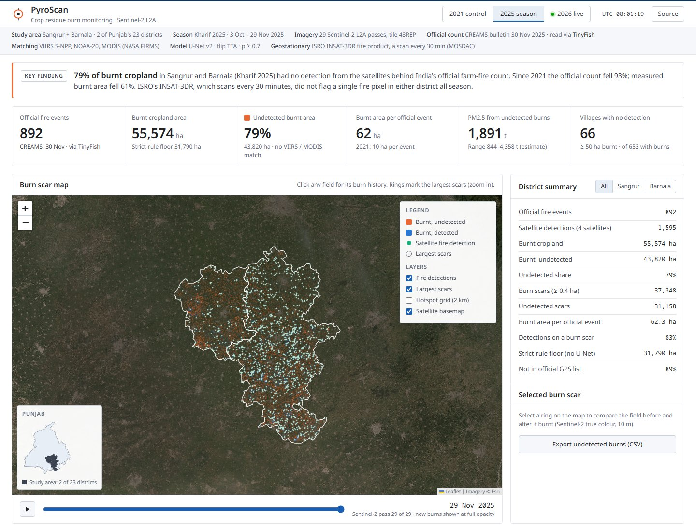
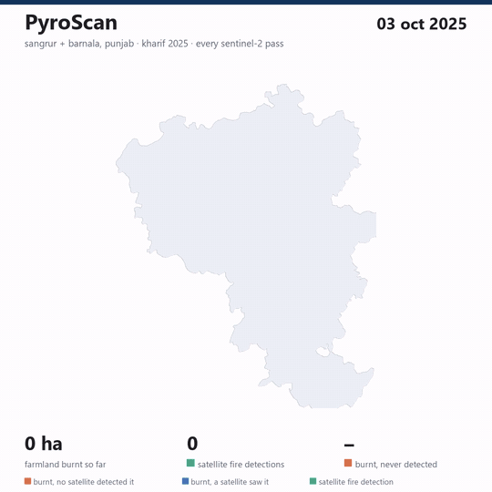

# PyroScan

[](https://github.com/1rishipathak/pyroscan/actions/workflows/ci.yml)

**the farm fires satellites miss.**

in india we count stubble fires with satellites that pass over punjab between 10:30 am and 1:30 pm. farmers now burn in the late afternoon. so the official fire count fell 93% in punjab between 2021 and 2025, while the fields kept burning.

PyroScan doesn't look for fire. it looks for what fire leaves behind, the black char on a harvested field, in every sentinel-2 image of the season. then it checks every burnt field against the same satellites the official count uses, and tells you which burns nobody counted.





*kharif 2025, every sentinel-2 pass: orange = burnt and never detected, blue = seen by satellite , green dots = fire detections.*
---


## Mermaid Diagram

```mermaid
flowchart TD

subgraph group_burn["Burn analysis"]
  node_config["Study configuration<br/>[config.py]"]
  node_scene_access["Scene access<br/>[s2.py]"]
  node_timeline["Clear-look timeline<br/>[timeline.py]"]
  node_indices["Burn indices and labels<br/>[indices.py]"]
  node_training["U-Net training<br/>[04_train.py]"]
  node_model["U-Net model<br/>[model.py]"]
  node_inference["Season inference<br/>[05_infer.py]"]
end

subgraph group_context["Fire context"]
  node_official_sources["Official count ingestion<br/>[sources.py]"]
  node_tinyfish["TinyFish client<br/>[tinyfish_client.py]"]
  node_news["Enforcement news<br/>[news.py]"]
  node_firms["FIRMS detections<br/>[firms.py]"]
  node_insat["INSAT fire analysis<br/>[mosdac.py]"]
end

subgraph group_publish["Results and dashboard"]
  node_emissions["Smoke estimates<br/>[emissions.py]"]
  node_geo["Punjab geography<br/>[geo.py]"]
  node_hotspots["Village hotspots<br/>[08b_hotspots.py]"]
  node_assets["Dashboard data generation<br/>[08_web_assets.py]"]
  node_dashboard["Interactive dashboard<br/>[app.js]"]
  node_api["HTTP API<br/>[main.py]"]
  node_timelapse["Season timelapse<br/>[11_timelapse.py]"]
end

subgraph group_external["External data"]
  node_s2[("Sentinel-2 scenes")]
  node_official["Official bulletins"]
  node_tinyfish_service{{"TinyFish APIs"}}
  node_insat_service[("INSAT-3DR scans")]
end

node_researcher(("Analyst"))

node_scene_access -->|"uses settings"| node_config
node_timeline -->|"uses settings"| node_config
node_timeline -->|"loads scenes"| node_scene_access
node_training -->|"uses settings"| node_config
node_training -->|"trains"| node_model
node_inference -->|"uses settings"| node_config
node_inference -->|"uses burn indices"| node_indices
node_inference -->|"walks scenes"| node_timeline
node_inference -->|"runs model"| node_model
node_official_sources -->|"uses settings"| node_config
node_official_sources -->|"fetches bulletins"| node_tinyfish
node_tinyfish -->|"queries"| node_tinyfish_service
node_news -->|"uses settings"| node_config
node_news -->|"searches and reads"| node_tinyfish
node_insat -->|"reads fire scans"| node_insat_service
node_assets -->|"uses settings"| node_config
node_assets -->|"calculates emissions"| node_emissions
node_assets -->|"uses scene data"| node_scene_access
node_assets -->|"uses geography"| node_geo
node_assets -->|"publishes dashboard data"| node_dashboard
node_hotspots -->|"uses settings"| node_config
node_researcher -->|"views results"| node_dashboard
node_researcher -.->|"requests data"| node_api
node_timelapse -->|"uses settings"| node_config
node_s2 -->|"provides imagery"| node_scene_access
node_official -->|"provides bulletins"| node_official_sources

click node_config "https://github.com/1rishipathak/pyroscan/blob/main/pyroscan/config.py"
click node_scene_access "https://github.com/1rishipathak/pyroscan/blob/main/pyroscan/s2.py"
click node_timeline "https://github.com/1rishipathak/pyroscan/blob/main/pyroscan/timeline.py"
click node_indices "https://github.com/1rishipathak/pyroscan/blob/main/pyroscan/indices.py"
click node_training "https://github.com/1rishipathak/pyroscan/blob/main/scripts/04_train.py"
click node_model "https://github.com/1rishipathak/pyroscan/blob/main/pyroscan/model.py"
click node_inference "https://github.com/1rishipathak/pyroscan/blob/main/scripts/05_infer.py"
click node_official_sources "https://github.com/1rishipathak/pyroscan/blob/main/pyroscan/sources.py"
click node_tinyfish "https://github.com/1rishipathak/pyroscan/blob/main/pyroscan/tinyfish_client.py"
click node_news "https://github.com/1rishipathak/pyroscan/blob/main/pyroscan/news.py"
click node_firms "https://github.com/1rishipathak/pyroscan/blob/main/pyroscan/firms.py"
click node_insat "https://github.com/1rishipathak/pyroscan/blob/main/pyroscan/mosdac.py"
click node_emissions "https://github.com/1rishipathak/pyroscan/blob/main/pyroscan/emissions.py"
click node_geo "https://github.com/1rishipathak/pyroscan/blob/main/pyroscan/geo.py"
click node_hotspots "https://github.com/1rishipathak/pyroscan/blob/main/scripts/08b_hotspots.py"
click node_assets "https://github.com/1rishipathak/pyroscan/blob/main/scripts/08_web_assets.py"
click node_dashboard "https://github.com/1rishipathak/pyroscan/blob/main/web/app.js"
click node_api "https://github.com/1rishipathak/pyroscan/blob/main/api/main.py"
click node_timelapse "https://github.com/1rishipathak/pyroscan/blob/main/scripts/11_timelapse.py"

classDef toneNeutral fill:#f8fafc,stroke:#334155,stroke-width:1.5px,color:#0f172a
classDef toneBlue fill:#dbeafe,stroke:#2563eb,stroke-width:1.5px,color:#172554
classDef toneAmber fill:#fef3c7,stroke:#d97706,stroke-width:1.5px,color:#78350f
classDef toneMint fill:#dcfce7,stroke:#16a34a,stroke-width:1.5px,color:#14532d
classDef toneRose fill:#ffe4e6,stroke:#e11d48,stroke-width:1.5px,color:#881337
classDef toneIndigo fill:#e0e7ff,stroke:#4f46e5,stroke-width:1.5px,color:#312e81
classDef toneTeal fill:#ccfbf1,stroke:#0f766e,stroke-width:1.5px,color:#134e4a
class node_config,node_scene_access,node_timeline,node_indices,node_training,node_model,node_inference toneBlue
class node_official_sources,node_tinyfish,node_news,node_firms,node_insat toneAmber
class node_emissions,node_geo,node_hotspots,node_assets,node_dashboard,node_api,node_timelapse toneMint
class node_s2,node_official,node_tinyfish_service,node_insat_service toneRose
class node_researcher toneIndigo
```



## results (sangrur + barnala, 3 oct – 29 nov 2025)

| | sangrur (incl. malerkotla) | barnala | **both** |
|---|---:|---:|---:|
| fire events in the official count (creams, 15 sep – 30 nov) | 787 | 105 | **892** |
| farmland that burnt (PyroScan u-net, sentinel-2) | 39,936 ha | 15,638 ha | **55,574 ha** |
| strict-rule floor (no u-net, char only) | 23,004 ha | 8,786 ha | 31,790 ha |
| burnt area no official-count satellite detected at all | 75% | 89% | **79%** |
| burnt area with no event in the official gps list | 86% | 95% | **89%** |
| hectares burnt per fire in the official count | 51 | 149 | **62** |

- the official count for these two districts fell from **13,715 fires in 2021 to 892 in 2025** (−93%). the burnt area PyroScan measures fell **61%** over the same years (see the control year below).
- even the strict floor is **36 ha of burnt land for every fire counted**, more than twice the 14 ha that one viirs fire pixel covers.
- **live, 2026 season so far (to the 18 oct pass):** 441 ha burnt in the two districts, against 3 fires in the official count.

### the control year: 2021

if farmers moved burning past the satellite passes, the same method run on a year *before* that shift should find most burns detected. iforest's meteosat data puts only 3% of large punjab fires after 3 pm in 2021, against over 90% in 2024–25. so PyroScan ran the 2025 model, unchanged, on all 25 sentinel-2 passes of kharif 2021:

| sangrur + barnala | 2021 | 2025 | change |
|---|---:|---:|---:|
| fire events in the official count | 13,715 | 892 | **−93%** |
| farmland that burnt (PyroScan) | 140,746 ha | 55,574 ha | **−61%** |
| strict-rule floor | 84,477 ha | 31,790 ha | −62% |
| burnt area no official-count satellite detected | **12%** | **79%** | ×6.6 |
| hectares burnt per official fire | **10** | **62** | ×6 |

burning did fall, by about three fifths. the count fell much faster, and the gap is the burns the satellites stopped seeing. in 2021 they missed about one burnt hectare in eight; in 2025, four in five. the per-fire ratio does not depend on how scars are matched to detections.

**is that just chance?** 2021 had 18 times more detections, so some burnt fields count as "seen" only because a detection happened to fall nearby. a null test measures how much: shift every detection by ±12 days (same places, wrong times) and match again. what still matches is chance. that is 18% of the burnt area in 2021 and 4% in 2025. corrected for chance, **the satellites missed 14% of burnt land in 2021 and 82% in 2025.**

a visual check of 2021 (`docs/qa_seen_2021.png`, `docs/qa_unseen_2021.png`) found the seen scars 81% clear and 19% probable burns by area, with none doubtful. the never-detected ones were 54% clear, 27% probable and 19% doubtful, mostly cloud shadows and haze next to small clouds, so the burnt area transfers well to a year the model never trained on.

### invisible smoke

the burns no satellite counted in 2025 released roughly **1,900 tonnes of pm2.5** (range 840–4,360 t), out of about 2,400 t from all burns in the two districts. in 2021 the never-detected part was about 720 t. **the smoke the count misses grew 2.6 times while total burning fell 61%.** that smoke is missing from emission inventories and air-quality forecasts that start from the fire count.

the estimate is deliberately conservative: 6.5 t of straw per hectare (the punjab pollution control board's own planning figure; pau quotes up to 9.5 t), 80% of it consumed (ipcc default for rice residue), and 8.3 g of pm2.5 per kg burnt (kim oanh et al. 2011, open-field rice straw; other field studies report 13–34 g/kg). that comes to 43 kg of pm2.5 per burnt hectare. the arithmetic is in `pyroscan/emissions.py`.

### where to send field teams

every burnt pixel is assigned to its nearest village (openstreetmap points, not revenue boundaries), and villages are ranked by burnt land no satellite detected (`scripts/08b_hotspots.py`, dashboard section *where to send field teams*, full list as csv).

- 2025: **66 villages had 50 ha or more of burnt farmland and not one satellite detection all season**. the worst, pakho kalan in barnala, had 714 ha burnt and one detection.
- 2021: **none** did.

### isro's geostationary satellite does not see these fires either

the polar satellites behind the official count look at about 10:30 am and 1:30 pm. isro's insat-3dr sits over the equator at 74°e and scans india every 30 minutes, day and night, and mosdac (sac/isro) publishes an active-fire product from every scan (`3RIMG_L2P_FIR`). round-the-clock geostationary monitoring is the fix usually proposed for the afternoon gap, so PyroScan reads that product for every season (`pyroscan/mosdac.py`, `scripts/12_insat_fires.py`, 4,474 product files):

| insat-3dr fire product over punjab | 2021 | 2025 | 2026 (to 19 oct) |
|---|---:|---:|---:|
| scans read | 1,150 (one an hour) | 2,588 (every scan) | 736 (every scan) |
| fire pixels flagged in punjab | **8** | **22** | 11 |
| …in sangrur + barnala | 0 | **0** | 0 |
| official fire events in punjab (creams) | 71,304 | 5,114 | 220 |

**it flagged 8 fire pixels over all of punjab in 2021**, a season with 71,304 official fire events, and not one in sangrur or barnala in any season. 20 of 2025's 22 pixels came between 11 am and 3 pm, hours the polar satellites already cover, and half of them sit on the same two spots day after day, which looks like industrial heat rather than farm fires. the product was built for forest fires, and a burning field fills a sliver of a 4 km (about 1,600 ha) pixel. so switching on geostationary monitoring as it is published today would not close the afternoon gap. a fire algorithm tuned for small crop fires, run on the raw insat scans, is the next step; until then, field-scale burn scars are the measure that works.

numbers are regenerated by the pipeline into `web/data/<season>/summary.json` and `insat.json`.

## why this matters

- the official count (creams, icar-iari) lists viirs on s-npp and noaa-20 and modis on terra and aqua as its sources. in practice every one of the 4,917 punjab events we read from the 2025 bulletins came from s-npp or aqua, and all but 41 were detected between noon and 4 pm.
- iforest's *stubble burning status report 2025* (dec 2025) used 15-minute meteosat data and found **over 90% of large punjab fires in 2024 and 2025 started after 3 pm, against 3% in 2021**. the same report says official fire counts fell over 90% since 2021, while burnt area fell much more slowly.
- in nov 2024 the supreme court asked for round-the-clock monitoring after hearing that farmers were told to burn after 4 pm.
- fire counts feed delhi's air-quality forecasts and emission estimates. a count that misses most fires understates how much of delhi's smog comes from the fields.

## how tinyfish is used

none of the official sources PyroScan checks itself against has an api. the official fire count lives in daily pdf bulletins behind a wordpress page. delhi's air-quality bulletin hides behind base64 links. enforcement action only exists as news. **tinyfish is how PyroScan reads the government web**, using three of its four apis:

| what PyroScan needs | tinyfish api | code |
|---|---|---|
| find every daily official fire bulletin (77 for 2025, one per day in 2026, 515 links back to 2018) | **fetch** with `links=True` on the creams bulletin page | `pyroscan/sources.py` · `creams_bulletins()` |
| read each bulletin pdf (about 40 pages): punjab's daily count, the district table for every year since 2020, and the gps, satellite and time of **every official fire event** | **fetch** on the pdf url | `sources.page_text()` → `parse_creams()`, `scripts/07b_official_events.py` |
| delhi's aqi for every day of the season, and today | **fetch** on cpcb's bulletin page and its pdfs | `cpcb_latest()`, `cpcb_url()`, `parse_cpcb_delhi()` |
| enforcement and court stories for the study districts | **search** (`domain_type=news`, india, date window) | `pyroscan/news.py` · `search_news()` |
| the numbers inside those stories: firs, red entries, fines, officials served notices | **web agent** with an `output_schema`, one run per article | `news.extract_facts()` |

for this submission that was **259 fetch calls (254 of them pdfs, across the 2021, 2025 and 2026 seasons), 37 searches and 11 agent runs**. fetch and search are free. the agent costs $0.016 a step, about 5 steps an article, so reading every enforcement story of a season costs well under a dollar.

the bulletins read through tinyfish give exactly the same counts as a local pdf parser (4,917 events for 2025, 219 for 2026), so the two paths cross-check each other.

every call goes through `pyroscan/tinyfish_client.py`. it caches results on disk (the dashboard keeps working offline) and logs each call (api, url, latency, ok) to `data/processed/tinyfish_log.jsonl`. the dashboard's **live** panel shows that log and has a *refresh with tinyfish* button: it pulls today's bulletin, today's aqi and this week's news while you watch. the **what the state did** section shows what the agent pulled out of the news.

without a key, the scripts fall back to a plain http download plus local pdf parsing, so you can still reproduce the numbers, just not the live panel or the news.

## how it works

```
sentinel-2 l2a (29 passes, 3 satellites)          nasa firms detections            creams + cpcb pdfs, news
  └─ cloud mask, 20 m, last-clear-look pairing     (viirs s-npp, noaa-20, modis)     └─ tinyfish fetch / search
       └─ automatic char labels (no hand-labelling)        │                               │
            └─ u-net, before+after, 11 channels            │                               │
                 └─ burn map, dated to (last clear look, this look]                        │
                      └─ burn scars ── matched by footprint + time ──┘                     │
                           └─ seen / never detected, per district, per day ── dashboard ───┘
```

1. **imagery.** every sentinel-2 l2a pass over tile 43REP between 3 oct and 29 nov 2025 (29 passes from sentinel-2a, 2b and 2c), read window-by-window from element84's public cloud-optimised geotiffs. 20 m grid, bands b03 b04 b8a b11 b12.
2. **pairing.** sentinel-2 sees each field every 2–5 days, often through cloud. for each pixel, "before" is its last clear look, so a burn is dated to a window.
3. **labels without hand-labelling.** the textbook burn index (dnbr > 0.1) flags 20–50% of the area *per week* here, because harvest itself drops it. so PyroScan labels a pixel *burnt* only when it turns charcoal-dark in visible and short-wave infrared light, has the flat swir signature of char (not wet soil) and changed since its last look. clearly bright straw, soil or green crop is *not burnt*. everything in between stays unlabelled. thresholds come from spectra next to firms fires and from 10 m true-colour checks (`docs/calibration/`).
4. **u-net.** a 7.8 m-parameter u-net takes before + after (5 + 5 bands + a validity mask) and learns the labels. it fills in the unclear fields from their shape and surroundings. 20% of 5 km blocks are held out for testing. predictions average 4 flips, and every detection must still pass a loose char check (the u-net proposes, physics disposes). the current model is v2. how it beat v1 is in [`docs/model.md`](docs/model.md).
5. **matching.** each burn scar (≥ 0.4 ha, one *killa*) is checked against firms detections from the four official-count satellites. a detection counts if the scar lies inside that detection's own pixel footprint (firms gives scan × track per point) plus 150 m, and inside the burn window. this is generous on purpose, so "never detected" is a floor.
6. **official numbers.** tinyfish fetch pulls the creams bulletins (official counts, district tables since 2020, every event's gps) and cpcb aqi bulletins. tinyfish search and the web agent collect what the state did: firs, red entries, fines, notices to officials.
7. **geostationary check.** isro's insat-3dr active-fire product from mosdac, every 30-minute scan of the season, day and night: its fire pixels over punjab and over the two districts (`pyroscan/mosdac.py`, `scripts/12_insat_fires.py`).

## validation, and what this does not prove

the u-net never saw a hand label, so PyroScan checks itself three ways:

| check | result |
|---|---|
| held-out 5 km blocks (never seen in training) vs the automatic labels | f1 0.998, iou 0.996 (agreement with the labels, not accuracy) |
| fires the official satellites **did** detect (on cropland, study area) that land on a PyroScan burn scar | **83%** (strict rule alone: 72%) |
| visual check of 48 random never-detected scars (area-weighted, before / after, 10 m true colour) | 31 clear burns, 15 probable, 2 doubtful. **by area: 86% clear, 14% probable, 0.5% doubtful** |

the sheet and the verdicts are in `docs/qa_unseen_2025.png` and `docs/qa_unseen_2025.csv`. an earlier version (no physics gate, 0.2 ha minimum) had 13 doubtful scars out of 48, mostly tiny ones and late-november fields darkened by tilling and irrigation for wheat. so every u-net detection now has to pass a loose char check, and a scar has to be at least one *killa* (0.4 ha, an acre, the usual punjab field unit).

we also checked *why* detected fires miss a scar (`scripts/diagnose_misses.py`). almost none were model misses. most were a field already char at the 11:15 am sentinel-2 pass and still burning at the ~1:30 pm satellite pass, which our first matching window was too strict to count as seen. that is fixed, and it lowered "never detected" from 83% to 79%. the 17% that still miss a scar are mostly a neighbouring field burning at a different time, and they are why the burnt area is a floor: small or short fires, smoke or cloud over the next pass, or a field tilled before sentinel-2 got a clear look.

- a scar nobody detected is not proof of evening burning. a fire can also be too small or too short, or hidden under smoke or cloud at overpass time.
- burnt area is a floor: a field burnt and tilled between two clear passes leaves no char for us to see.
- district borders are geoboundaries' pre-2021 version, so "sangrur" includes malerkotla. official counts are added up the same way (sangrur + malerkotla).

## revenue model

the raw inputs are free (sentinel-2, firms, government bulletins) and one season for two districts costs about an hour of a laptop gpu. what costs money today is *not knowing which field burned*. that is what PyroScan sells.

| who pays | what they get | how it is priced |
|---|---|---|
| **state pollution control boards, caqm, agriculture departments** | an independent burnt-area audit next to the official count, every week of the season. district and village totals, and an evidence list of burnt fields with dates for field teams. | annual licence per state |
| **crop insurers and agri-lenders** | the burn history of any field (`/api/check?lat=&lon=`). burning is penalised, and it signals how a farm is managed. | per hectare checked, via api |
| **no-burn incentive schemes and straw buyers** (state per-acre incentives, csr residue-management programmes, biomass pellet and cbg plants that pay farmers for straw) | proof that an enrolled field did *not* burn before paying out | per field verified, per season |
| **residue-management carbon and esg projects** | measurement, reporting and verification (mrv) of "no burn" claims | per verified hectare |

the public dashboard stays free: it is how journalists, researchers and citizens hold the numbers to account, and it is the best advert for the paid tiers.

**why now:** the supreme court asked for round-the-clock monitoring in 2024, and the official counts keep falling while delhi's air does not. agencies need a second opinion that is cheap and independent, and that works at field scale.

## run it

### just the dashboard: one minute, no gpu, no pytorch

every season is precomputed in `web/data/`, so the dashboard and api need only a light install.

- **windows:** double-click `run.bat`
- **mac / linux:** `./run.sh`
- **by hand:**

```bash
git clone https://github.com/1rishipathak/pyroscan.git && cd pyroscan
python -m venv .venv && .venv/Scripts/activate        # linux/mac: source .venv/bin/activate
python -m pip install -r requirements-app.txt
cp .env.example .env      # optional: add TINYFISH_API_KEY for the live panel (free key: https://agent.tinyfish.ai/api-keys)
python -m uvicorn api.main:app --port 8000
```

open http://localhost:8000.

**tests:** `pip install pytest && pytest`. there are 23 tests: the bulletin readers on real 2021, 2025 and 2026 bulletin text (three different layouts) and two aqi layouts, the burn-label physics on hand-made pixels, the mosdac reader on a real insat-3dr fire file (with its run-on temperature field), and the api against the shipped data. they run on every push (`.github/workflows/ci.yml`) without a tinyfish key or pytorch.

### the full pipeline (gpu recommended)

```bash
pip install torch --index-url https://download.pytorch.org/whl/cu126   # or the cpu wheel
pip install -r requirements.txt
```

rebuild everything from scratch (about 1.5 h on a laptop rtx 4070, most of it downloading 3.5 gb of imagery):

```bash
python scripts/01_prepare_aoi.py --season 2025     # study window, district raster, cropland mask, scene list
python scripts/02_download_s2.py --season 2025     # 29 sentinel-2 passes, windowed cog reads
python scripts/02b_firms.py                        # firms points per district, 2021-2025
python scripts/03_make_labels.py --season 2025     # automatic char labels + training patches
python scripts/04_train.py --season 2025           # u-net
python scripts/05_infer.py --season 2025           # season burn map (u-net and rule baseline)
python scripts/07_sources.py --season 2025 --live --agent 10  # official counts, aqi, news + agent extraction (tinyfish)
python scripts/07b_official_events.py --season 2025  # every official fire event with gps, from all 77 bulletins
python scripts/06_scars.py --season 2025           # scars, matched against firms
python scripts/06_scars.py --season 2025 --source rule
python scripts/06_scars.py --season 2025 --detections official
python scripts/06_scars.py --season 2025 --source rule --detections official
python scripts/08_web_assets.py --season 2025      # dashboard data
python scripts/08b_hotspots.py --season 2025       # villages ranked by never-detected burns
python scripts/09_qa_sheet.py --season 2025        # random scars for a human check
python scripts/12_insat_fires.py download --plan 2025:30 2021:60   # isro insat-3dr fire product (mosdac login)
python scripts/12_insat_fires.py extract --season 2025              # its fire pixels over punjab, for the dashboard
```

the insat step needs a free [mosdac](https://www.mosdac.gov.in/) account. put `username=...` and `password=...` in a text file outside the repo and point `MOSDAC_CREDS_FILE` at it (in the shell or in `.env`). the script logs in once per run and never retries a failed login (three failures lock the account for an hour), keeps under mosdac's limits (5,000 files a day, 300 a minute), and renews its five-minute token without the password.

the **2021 control season** runs the same steps with the 2025 model, no retraining:

```bash
python scripts/01_prepare_aoi.py --season 2021 && python scripts/02_download_s2.py --season 2021
python scripts/05_infer.py --season 2021 --model 2025
python scripts/06_scars.py --season 2021 && python scripts/06_scars.py --season 2021 --source rule
python scripts/07_sources.py --season 2021 --skip-news && python scripts/08_web_assets.py --season 2021
```

to refresh the **live season** (new sentinel-2 passes, new official bulletins, today's aqi and news) in one go:

```bash
python scripts/10_live_update.py
```

it runs the same steps with `--season 2026` (no training: `05_infer.py --season 2026 --model 2025`, and scars are matched against the official gps list with `--detections official`, since firms has no keyless archive for the current year). with `MOSDAC_CREDS_FILE` set it also pulls the day's insat-3dr fire files.

## repo

```
pyroscan/            library: sentinel-2 access, labels, u-net, firms, tinyfish client, official sources, news, mosdac (insat)
scripts/          the pipeline, 01 → 12
api/main.py       fastapi: dashboard, live tinyfish refresh, field check, evidence export
web/              dashboard (leaflet + chart.js) and its precomputed data
docs/             calibration plots, qa sheets, model comparison (model.md), notes
reports/          training curves, model comparison, null test, scores
checkpoints/      trained u-net
tests/            pytest: bulletin readers (3 years of formats), label physics, api
requirements-app.txt, run.bat, run.sh   the light dashboard-only install
```

## data and credits

copernicus sentinel-2 (esa), via element84 earth search on aws · nasa firms (viirs, modis) · insat-3dr active-fire product, mosdac (sac/isro) · creams lab, icar-iari (paddy residue burning bulletins) · cpcb (aqi bulletins) · esa worldcover 2021 · geoboundaries (adm2) · openstreetmap contributors (village names, odbl) · iforest, *stubble burning status report 2025*.

## team

- Akshya Kaushik
- Priyanshi Juneja
- Rishi Pathak
- Swaraj
- Ananya Jain
